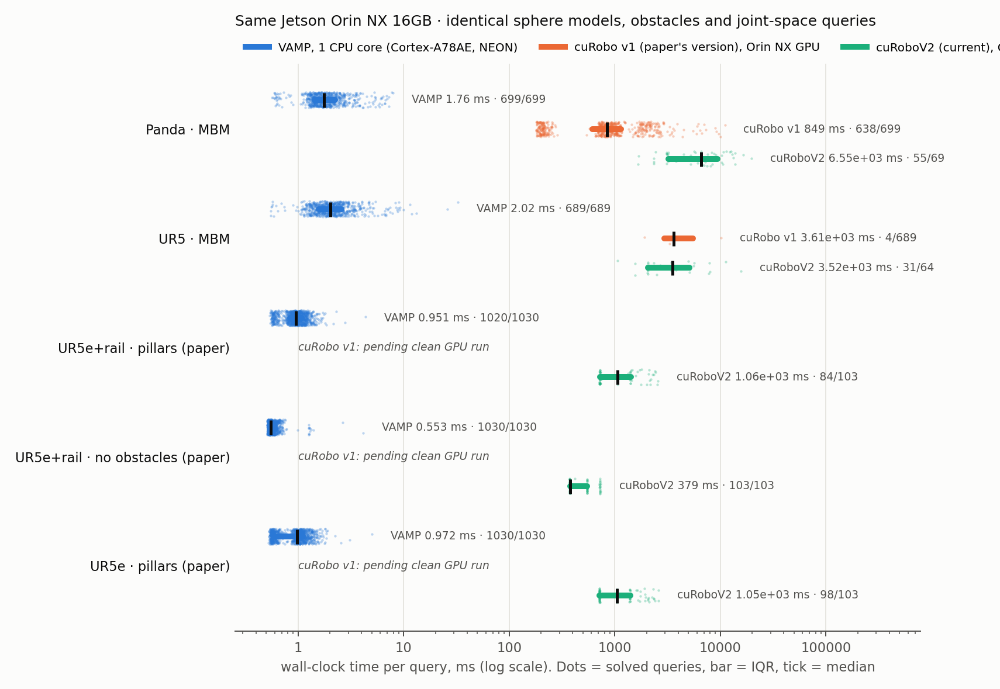
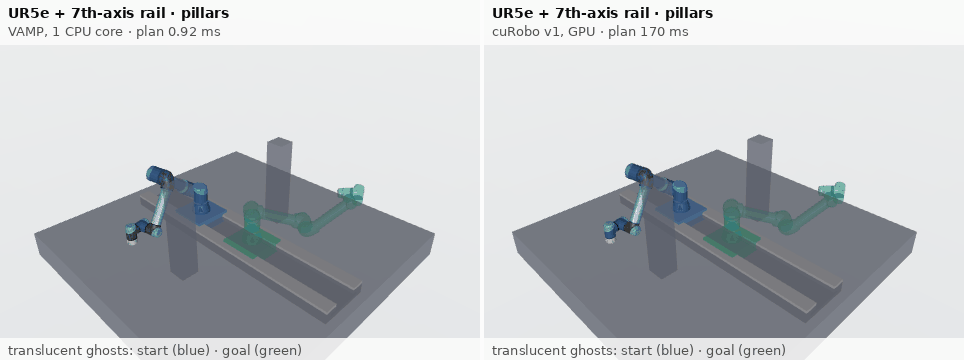
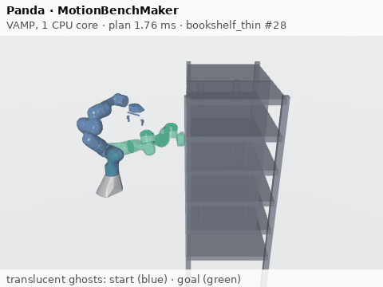
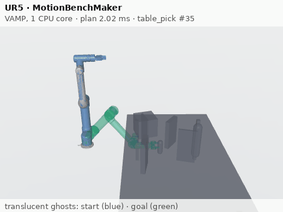
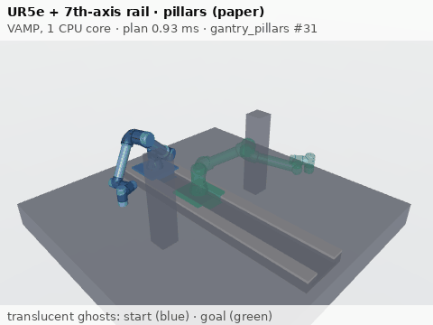
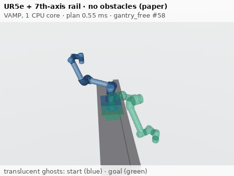
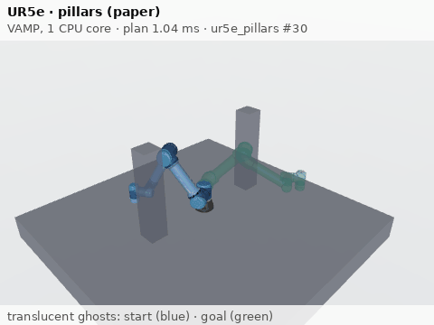

# VAMP vs cuRobo (v1 and V2) on one Jetson

This repo compares three motion planners on the same board, a Jetson Orin NX 16 GB:
- **[VAMP](https://github.com/KavrakiLab/vamp):** a CPU SIMD-vectorized RRT-Connect, running on one Cortex-A78AE core with NEON.
- **cuRobo v1:** the version our paper used (arXiv 2508.04146), running on the Orin NX GPU.
- **cuRoboV2:** the current cuRobo, also on the Orin NX GPU.

The problems:
- **Standard benchmark:** VAMP's MotionBenchMaker problems for the Panda and the UR5.
- **Our paper's scenes:** a UR5e on a 7th-axis rail, and a fixed-base UR5e.

All three planners check the same collision spheres against the same obstacles, and all three get the same joint-space start and goal. On 16,000 random configurations, the collision checkers gave the same answer 100% of the time (`results/collision_model_agreement.json`). We report only comparisons measured on this board.



## The benchmark tasks

Same query, same scene: VAMP (left) and cuRobo v1 (right) on the paper's UR5e + rail scene with pillars. Each title shows that planner's measured planning time for this query.



One representative query per problem set, executed with VAMP's solution. The query is the one whose VAMP time is closest to its set's median (first trial).

| | |
|---|---|
|  |  |
|  |  |
|  | |

How the GIFs are made:
- **Rendering:** MuJoCo offscreen rendering (`bench/render_gifs.py`).
- **Obstacles:** drawn exactly as the planners model them.
- **Robot models:**
  - UR5e: `curobo_berkeley`'s `ur5e.xml` and rail meshes, with the Vention pedestal removed because no planner models it.
  - Panda and UR5: VAMP's URDFs. The UR5 is drawn with its collision meshes.
- **Kinematics check:** each MuJoCo model's end-effector pose is checked against VAMP's forward kinematics. Panda and UR5 match to below 0.001 mm. The UR5e meshes come from a different model than the planning URDF and differ by up to 1.5 mm.
- **Timing:** paths are replayed at constant joint speed over 6 s, with 1 s holds at start and end. Display time is not planning time.
- **Per-GIF details** (query, measured time, file size): `results/media/manifest.json`.

## Headline (Panda, MotionBenchMaker, this Orin NX)

| | Solved | Median wall time per query (IQR) | Median path length |
|---|---|---|---|
| **VAMP**, 1 CPU core | 699/699 | **1.76 ms** (1.44–2.25) | 4.90 rad |
| **cuRobo v1**, GPU | 638/699 | **849 ms** (616–1147) | 4.32 rad |
| **cuRoboV2**, GPU, every 10th problem | 59/69 (`max_attempts` 20, not NVIDIA's 100) | **6.55 s** (3.23–9.44) | 4.51 rad |

Same-query comparisons:
- **VAMP vs cuRobo v1:** on all 699 queries, v1's median time is **483x** VAMP's (ratio of medians).
- **VAMP vs cuRoboV2:** on the 69 queries V2 ran, VAMP's median is 1.72 ms, and V2's median is **3817x** that. V2 solved 59/69 with `max_attempts` 20; NVIDIA's own benchmark uses 100, so V2's success rate is a lower bound.
- **v1 vs V2:** on those same 69 queries, v1 solves 64 with a median of 869 ms.

So on this board, VAMP on one of the 8 CPU cores is about 500x faster than cuRobo v1 on the whole GPU, and cuRoboV2 is slower than v1. The GPU does not give cuRobo a speed advantage here. All three run on the same board, so per-dollar is the same for all of them.

## All problem sets

Wall-clock time per query; median, with p95 in parentheses. **Solved** means the planner reported success. This definition is used everywhere in this repo: tables, figure and `docs/EMAIL_NOTES.md`. A provisional cross-check with VAMP's checker is described below, and it does not change these counts.

| Problem set | VAMP | cuRobo v1 | cuRoboV2 |
|---|---|---|---|
| Panda · MBM (7 scenes) | 699/699 · 1.76 ms (3.89) | 638/699 · 849 ms (2694) | 59/69³ · 6.55 s (13.9 s) |
| UR5 · MBM (7 scenes) | 689/689 · 2.02 ms (4.80) | 367/689¹ · 827 ms (2.18 s) | 35/64¹ ³ · 4.52 s (16.6 s) |
| UR5e + rail · pillars (paper) | 1020/1030 · 0.95 ms (1.35) | 823/1030 · 161 ms (433) | 100/103³ · 1.06 s (2.28 s) |
| UR5e + rail · no obstacles (paper) | 1030/1030 · 0.55 ms (0.68) | 1030/1030 · 145 ms (154) | 103/103³ · 379 ms (727) |
| UR5e · pillars (paper) | 1030/1030 · 0.97 ms (1.43) | 985/1030 · 377 ms (613) | 102/103³ · 1.05 s (2.32 s) |

Ratio of median wall time to VAMP's, on the same queries:

| | Panda | UR5 | rail/pillars | rail/free | UR5e/pillars |
|---|---|---|---|---|---|
| cuRobo v1 | 483x | 409x | 169x | 261x | 388x |
| cuRoboV2 | 3817x | 2225x | 1117x | 684x | 1079x |

¹ **UR5 velocity limit.** VAMP's `ur5_spherized.urdf` caps every joint at 0.5 rad/s. VAMP ignores velocity limits, but cuRobo's time-parameterized optimizer cannot fit long motions under that cap: with it, v1 solved 4/689 and V2 33/64. Both cuRobo versions therefore get a copy of the URDF with identical geometry and the real UR5 limit of π rad/s (`configs/ur5_spherized_vel_pi.urdf`).
- Even with that fix, v1 fails 322 UR5 queries. Almost all are `TRAJOPT_FAIL`, mostly in `cage` (2/100 solved) and the bookshelves.
- The superseded runs are in `results/raw/superseded/` and in `summary.json` → `superseded`.

³ **cuRoboV2 success rates** were measured with `max_attempts` 20 (the same cap as v1). NVIDIA's own V2 benchmark uses 100, so these rates are a lower bound.

**Provisional: small penetrations between waypoints, in both cuRobo versions.** VAMP's segment check runs on the straight line between consecutive returned waypoints (`bench/crossval.py`). It flags some successes of both versions:

| | Panda | UR5 | rail/pillars | rail/free | UR5e/pillars |
|---|---|---|---|---|---|
| cuRobo v1 flagged | 0 of 638 | 4 of 367 | 44 of 823 | 0 of 1030 | 3 of 985 |
| cuRoboV2 flagged | 4 of 59 | 6 of 35 | 16 of 100 | 0 of 103 | 4 of 102 |

What the checks found:
- **Not a model artifact.** V2's own collision checker agrees with VAMP on 12,000/12,000 random configurations. It also confirms all 24 flagged V2 trajectories it was run on (Panda, rail/pillars, UR5e/pillars), at exactly the same samples ([docs/V2_COLLISION_CHECK.md](docs/V2_COLLISION_CHECK.md)).
- **Millimetre-scale.** Exact signed distances on the shared model (`bench/penetration_depth.py`, which matches V2's own checker within 0.001 mm on each of the 24 flagged V2 trajectories) give:
  - median penetration 0.12–2.30 mm per set, maximum 5.08 mm across all sets;
  - always between waypoints, never at one.
  - Joint limits are checked with 1e-5 rad of tolerance for float rounding.
- **Unresolved:** whether cuRobo's continuous trajectory itself penetrates. Our dense re-sampling of V2's spline failed its self-check.

None of this changes the solved counts above.

**VAMP's one failure.** VAMP's only failures are a single rail/pillars query (problem 64). It fails on all 10 seeds, each after about 4.2 s at the default iteration cap.

**Python overhead.** About 0.5 ms of each VAMP wall time is the Python binding and environment conversion. VAMP's C++ planning + simplification medians are 1.20 ms (Panda), 1.46 ms (UR5), 0.40 / 0.03 / 0.44 ms (paper scenes).

Every number above is in `results/summary.json` (built by `bench/analyze.py` from `results/records/`).

## Settings and caveats
- **VAMP:** library defaults (`rrtc` + `simplify`, Halton sampler), the same as its own `scripts/evaluate_mbm.py`. Paper scenes: 10 seeds per query.
- **cuRobo v1** (`ebb7170`, v0.7.7-5): the settings of its own `benchmark/curobo_benchmark.py` (12 seeds, 20 attempts, graph planner from attempt 1, finetuning, CUDA graphs, warmed up). Paper scenes: 10 seeds per query.
- **cuRoboV2** (`ac5f931`, v0.8.0.post1.dev33; the existing build in `~/projects/clean_env/venv`, not rebuilt):
  - Settings are those of NVIDIA's `benchmark/motion_plan_benchmark.py`: particle + L-BFGS IK and trajopt, 4 trajopt seeds, activation distance 0.0025, CUDA graphs, `warmup(enable_graph=True)`, `reset_seed()` before each query, graph seeding from attempt 1.
  - We cap `max_attempts` at 20 (the same as v1; V2's benchmark uses 100) to fit the shared GPU slot.
  - V2 takes a median 0.38–6.55 s per query (up to 19.7 s), so it runs a fixed subset: every 10th MBM problem, and one trial per paper problem.
  - Every recorded setting is in `results/records/curobo2_*.json`.
- **Outputs differ in kind.** Both cuRobo versions return smooth, time-parameterized, jerk-limited trajectories. VAMP returns a geometric path that still needs time parameterization.
- **Machine load during the GPU slot** (2026-10-07 17:42–21:06):
  - The GPU had read 0% for 10 minutes before the start.
  - Another job's demo collector (`collect_local.py`, 5 workers, light EGL rendering) kept about 5 of the 8 CPU cores busy for the whole slot.
  - cuRobo's CPU-side kernel launches may have been slowed by this. Its GPU share could not be measured separately. VAMP ran in a separate window.
- **No per-watt figure.** Board power is logged for each run (`tegrastats`, under `power` in `summary.json`), but with the other job running, cuRobo's energy per query can't be isolated.

Full method, the paper-scene definitions and deviations from the paper's scripts: [docs/METHOD.md](docs/METHOD.md).

## Reproduce
```bash
# VAMP (isolated venv; builds on aarch64/NEON, x86 AVX2 or Apple Silicon)
git clone --recursive https://github.com/KavrakiLab/vamp third_party/vamp   # 27cb9b6
python3 -m venv .venv && .venv/bin/pip install numpy fire pyyaml tqdm pandas tabulate matplotlib
cp configs/ur5e.hh third_party/vamp/src/impl/vamp/robots/ur5e.hh            # generated by cricket fb2d081
cp configs/ur5e_rail.hh third_party/vamp/src/impl/vamp/robots/ur5erail.hh
CMAKE_BUILD_PARALLEL_LEVEL=3 .venv/bin/pip install ./third_party/vamp \
  -C cmake.define.VAMP_ROBOT_MODULES="sphere;ur5;panda;fetch;baxter;ur5e;ur5erail" \
  -C cmake.define.VAMP_ROBOT_STRUCTS="Sphere;UR5;Panda;Fetch;Baxter;UR5e;UR5eRail"
(cd third_party/vamp && ../../.venv/bin/python resources/problem_tar_to_pkl_json.py --robot panda \
  && ../../.venv/bin/python resources/problem_tar_to_pkl_json.py --robot ur5)

# cuRobo v1: docs/CUROBO_JETSON_FIX.md.  cuRoboV2: an existing local build (not on PyPI).
bench/run_all.sh --vamp-only      # CPU
bench/run_all.sh --curobo-only    # GPU (v1, then V2, then the VAMP cross-check); run on an idle GPU
.venv/bin/python bench/analyze.py # -> results/summary.json, results/records/, results/figure.png
```
- Paper-scene problems: `problems/*.pkl`, built by `bench/make_paper_problems.py`.
- Shared-model converters: `bench/spherized_to_curobo.py`, `bench/curobo_to_spherized.py`, `bench/v1cfg_to_v2.py`.
- Collision-model check: `bench/agreement.py`.

## Also in this repo
- [docs/SPEEDUP_CLAIMS.md](docs/SPEEDUP_CLAIMS.md): which cuRobo speedup numbers (62x / 50x / 12x, and the paper's 15–25x and 8x) a results file supports. None of them is.
- [docs/BENCHMARK_V2.md](docs/BENCHMARK_V2.md): the design for a broader benchmark (held-out problems, time to an executable trajectory, quality, variance, industrial motion types). Not yet run.
- [docs/PAPER_CLAIMS_AUDIT.md](docs/PAPER_CLAIMS_AUDIT.md): each quantitative claim in arXiv 2508.04146 checked against the committed experiments.
- [docs/CUROBO_JETSON_FIX.md](docs/CUROBO_JETSON_FIX.md): why cuRobo v1 was broken on this machine, and the non-destructive fix.
- [docs/VEGA_CUROBO_NOTE.md](docs/VEGA_CUROBO_NOTE.md): how vega_curobo's cuRoboV2 config differs from ours, on this board.
