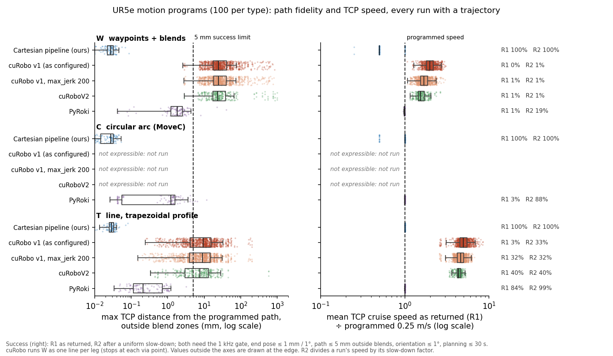

# Benchmark v2.2: industrial motion types (results)

Pre-registration and amendments V1, V2, V2a, with probe P0: `docs/V2_2_MOTION_TYPES_PREREGISTRATION.md`. Numbers: `results/v2_2/summary.json`, produced by `bench/v2_2_analyze.py` from `results/v2_2/raw/`. Figure: `results/v2_2/motion_types.png` (`bench/v2_2_figure.py`).

## Setup
- **Programs:** 100 UR5e cells (bin, conveyor and fixture stations), each with one program of each type, run from a given start configuration with the tool pointing down:
  - **W:** a path through 3–6 via points with circular blends (r ≤ 5 cm), at a constant 0.25 m/s through the blends;
  - **C:** a horizontal circular arc through start, via and end (MoveC), at 0.25 m/s;
  - **T:** a straight line 0.30–0.59 m long with a trapezoidal TCP profile (a = 0.25 m/s², v = 0.25 m/s).
- **Time law:** every program's time law is jerk-limited on arc length (TCP jerk 10 m/s³).
- **Success per run:**
  - the 1 kHz gate (no collision, joint bounds, and peak velocity, acceleration and jerk ≤ 1.01 × the shared limits, with jerk 500 rad/s³);
  - planning ≤ 30 s;
  - end pose ≤ 1 mm and 1°;
  - max TCP distance from the programmed path ≤ 5 mm outside blend zones, and orientation ≤ 1°.
  - Speed, blend and profile behaviour are measured but are not part of success, since some planners have no speed input.
- **R1 and R2:**
  - R1 is the trajectory as returned.
  - R2 applies a uniform slow-down to runs that failed only on velocity, acceleration or jerk. Path geometry is unchanged and speeds are divided by the slow-down factor.
- **Runs:**
  - cuRobo v1: 10 seeds, both as configured (`max_jerk` 500) and with `max_jerk` 200, the positive control from v2.
  - cuRoboV2: 3 seeds.
  - PyRoki: one deterministic run.
  - Cartesian pipeline: one deterministic run, with T_ready the median of 10 timed repeats.
- **Hardware:** one Jetson Orin NX 16 GB. GPU planners ran with no other GPU work. The Cartesian pipeline was timed on a quiet CPU.
- **Program set:** the generator kept 100 of 817 candidate cells (12%).
  - **Validity rule (V1):** a program is kept only if the path has a continuous collision-free IK solution and stays at least 0.35 m from the base axis and within 0.70 m of the shoulder.
  - **Skew:** the set leans toward easy programs. W has 3 vias in 52 programs (4: 24, 5: 13, 6: 11), against the uniform 3–6 that was drawn. C sweeps have a median of 139° (range 90–269°) and radii a median of 0.14 m.
  - **Clearance:** fewer than 30 programs per type have less than 5 cm minimum clearance, so the clearance bins below 5 cm are underpowered.

## E: how each planner expresses each motion

| Motion | Cartesian pipeline (ours) + VAMP check | cuRobo v1 | cuRoboV2 | PyRoki |
|---|---|---|---|---|
| **W** waypoints + blends | our post-processing | **closest native motion:** one MoveL per leg, stopping at each via point. Of 483 legs: 0 native lines, 15 plane holds, 468 orientation-only | as v1 (probe P0 failed) | native costs in our harness: a pose cost per knot at the programmed time law |
| **C** MoveC | our post-processing | **not expressible**, not run | **not expressible**, not run (P0 failed) | as for W |
| **T** trapezoidal MoveL | our post-processing; profile exact | **path:** 0 of 100 lines native, 1 plane hold, 99 orientation-only. **Profile:** not expressible (no TCP speed or acceleration input) | as v1 | per-knot targets at the programmed timing |

- **Line holds in cuRobo:** both versions hold a straight line by holding axes of the goal frame or the base frame. An axis can be held only when the line's displacement along it is ≤ 1 mm.
  - A tool-down line in an arbitrary horizontal or oblique direction usually has no such axis. Only orientation is then held, and the TCP path between the endpoints is free.
- **Per-timestep targets in cuRoboV2 (probe P0):** the API documents per-timestep tool-pose targets. Its trajectory optimiser rejects a goal with horizon > 1 on every dev program and setting tried, because the goal buffer is allocated with horizon 1. So V2 has no native way to follow a programmed path or timing.
- **What the cuRobo columns measure:** cuRobo is run on motions it was not built to express, through the closest native motion. Its results below are the cost of that gap, not a measure of its free-space planning.

## Results

### W: waypoints with blends (100 programs)

| | Cartesian pipeline | cuRobo v1 (as configured) | cuRobo v1, max_jerk 200 | cuRoboV2 | PyRoki |
|---|---|---|---|---|---|
| Success, R1 | 100/100 | 0/1000 | 10/1000 | 3/300 | 1/100 |
| Success, R2 | 100/100 | 10/1000 | 10/1000 | 3/300 | 19/100 |
| Programs failing on every seed | 0 | 100 | 99 | 99 | 99 |
| Max deviation outside blends, median / p95 (mm) | 0.03 / 0.04 | 24.35 / 154.26 | 24.36 / 155.74 | 23.42 / 457.93 | 1.82 / 3.78 |
| Blend-zone deviation, median / p95 (mm) | 0.01 / 0.02 | 30.27 / 281.84 | 30.25 / 285.75 | 29.50 / 471.27 | 3.49 / 5.48 |
| Orientation deviation, p95 | 0.03° | 2.77° | 2.69° | 90.00° | 1.18° |
| Cruise speed ÷ programmed (median) | 0.50 | 1.98 | 1.69 | 1.54 | 0.99 |
| Max cruise speed error, median / p95 | 50.2% / 50.3% | 316.9% / 446.0% | 247.2% / 420.8% | 220.5% / 562.8% | 12.1% / 27.5% |
| Via points: median min speed ÷ programmed | 0.50 | 0.00 | 0.00 | 0.00 | 0.95 |
| … stopped (≤ 0.05) / held (≥ 0.9) | 0% / 21.9% | 100.0% / 0.0% | 100.0% / 0.0% | 100.0% / 0.0% | 0% / 72.8% |
| Main failure | — | jerk (1000 runs) and path (990) | path (990) | path (297) | planning > 30 s (79), jerk (98) |

- **Which runs are counted:**
  - Deviation and speed rows cover every run with a trajectory, successful or not; every run returned one.
  - The single cuRobo program that succeeds (all 10 v1 seeds, all 3 V2 seeds) is one 3-via program. Its four legs all fall in the orientation-only class and happen to stay within 5 mm.
- **Cartesian pipeline:** the programmed 0.25 m/s through circular blends exceeds the joint jerk limit on 76 of 100 programs (and the acceleration limit too on 19 of them; median jerk ratio 1.4 at the programmed speed).
  - **Curvature step:** a circular blend starts with a step in path curvature, and at 0.25 m/s that step is a jerk spike in the joints.
  - **Pre-registered retry:** the program speed halves until the trajectory passes. It took one halving on 74 programs and two on 2.
  - **Through the blends:** it holds its own cruise speed (median per-via minimum 0.998 of its cruise speed). Against the programmed speed it does neither of the pre-registered blend outcomes (median 0.50).
- **PyRoki:**
  - **Planning time:** W needs 154 knots, and planning takes a median of 41.0 s, so 79 of 100 programs exceed the 30 s budget.
  - **As returned:** the trajectories keep the programmed speed through the blends (median 0.95), but 98 of 99 failures exceed the jerk limit.
  - **After R2:** 19 of the 21 programs planned within budget pass (one already as returned), at a median slow-down of 1.26. The 18 slowed runs cruise at a median 0.76 of the programmed speed.

### C: circular arc (MoveC; 100 programs)

| | Cartesian pipeline | cuRobo v1 / cuRoboV2 | PyRoki |
|---|---|---|---|
| Success, R1 | 100/100 | not expressible | 3/100 |
| Success, R2 | 100/100 | | 88/100 |
| Max deviation outside blends, median / p95 (mm) | 0.03 / 0.04 | | 1.21 / 4.72 |
| Orientation deviation, p95 | 0.03° | | 0.44° |
| Cruise speed ÷ programmed (median) | 1.00 | | 1.00 |
| Max cruise speed error, median / p95 | 0.3% / 50.2% | | 6.3% / 13.7% |
| T_ready (median) | 0.20 s | | 11.11 s (R1 successes, n = 3) |
| T_cycle, R2 (median) | 2.08 s | | 13.86 s (n = 88) |

- **Cartesian pipeline:** 15 of 100 arcs exceed the jerk limit at the programmed speed and needed one speed halving.
- **PyRoki:**
  - **As returned:** it holds the arc and the programmed speed, but 97 of 100 runs exceed the jerk limit (92 on dynamics alone).
  - **After R2:** 88 pass at a median slow-down of 1.62 (p95 2.40), so their cruise runs at a median 0.60 of the programmed speed.

### T: line with a trapezoidal profile (100 programs)

| | Cartesian pipeline | cuRobo v1 (as configured) | cuRobo v1, max_jerk 200 | cuRoboV2 | PyRoki |
|---|---|---|---|---|---|
| Success, R1 | 100/100 | 29/1000 | 319/1000 | 120/300 | 84/100 |
| Success, R2 | 100/100 | 328/1000 | 319/1000 | 120/300 | 99/100 |
| Programs failing on every seed | 0 | 91 | 66 | 60 | 16 |
| Max deviation, all runs, median / p95 (mm) | 0.03 / 0.04 | 9.27 / 39.20 | 9.01 / 39.13 | 7.59 / 28.10 | 0.21 / 1.08 |
| Max deviation, successful runs, median / p95 (mm) | 0.03 / 0.04 | 3.62 / 4.92 | 2.58 / 4.68 | 2.33 / 4.84 | 0.17 / 0.80 |
| Cruise speed ÷ programmed (median) | 1.00 | 4.93 | 4.63 | 4.36 | 1.00 |
| Ramp acceleration error (median) / ramp duration ÷ programmed | 2.3% / 1.00 | 2645.8% / 0.18 | 2257.4% / 0.20 | 2083.0% / 0.23 | 6.8% / 1.00 |
| T_ready, successful runs (median) | 0.25 s | 0.62 s | 0.63 s | 1.01 s | 8.90 s |
| T_exec (median) | 2.64 s | 0.58 s | 0.50 s | 0.54 s | 2.68 s |
| T_cycle (median, 95% CI) | 2.90 s [2.79, 3.00] | 1.22 s [1.11, 1.32] | 1.14 s [1.12, 1.16] | 1.57 s [1.53, 1.61] | 11.64 s [10.53, 12.16] |

- **cuRobo:**
  - **Speed:** it moves the line at its own time-optimal speed, a median 4.4–4.9 times the programmed 0.25 m/s, with ramps 4–6 times shorter than programmed.
  - **Path:** failed runs fail on path deviation, because the orientation-only line drifts.
  - **Line length:** success falls with line length. With `max_jerk` 200 it is 46% on lines shorter than the median (0.40 m) and 18% on longer ones; cuRoboV2 gets 52% and 28%.
- **cuRobo v1 as configured:** as in v2, its trajectories exceed the jerk limit (898 of 971 failures). R2 recovers 299 of them.
- **PyRoki:** follows the profile: ramp acceleration within 6.8% and ramp durations as programmed. Its 16 failures exceed the dynamics limits; R2 recovers 15 at a median slow-down of 1.00 (p95 1.27).

## Reading against the pre-registered questions
- **Q1, path fidelity** (successful runs: median ≤ 1 mm, p95 ≤ 5 mm):
  - **Cartesian pipeline:** holds every type (0.03 / 0.04 mm).
  - **PyRoki:** holds T (0.17 / 0.80 mm). C passes the same mark on its 3 R1 successes (0.67 / 1.39 mm), too few to judge.
  - **cuRobo:** does not hold the T line (median 2.3–3.6 mm on its successes, 7.6–9.3 mm over all runs). W is not judged: one program succeeds.
- **Q2, constant speed** (max cruise speed error: median ≤ 10%, p95 ≤ 25%):
  - **Holds:** the Cartesian pipeline on T; PyRoki on T and, as returned, on C.
  - **Misses:** the Cartesian pipeline on C (p95 50.2%, from the 15 halved arcs) and on W (50.2%, halved); PyRoki on W (12.1% / 27.5%); cuRobo on every type it runs (median cruise 1.5–4.9 times the programmed speed).
  - **After R2:** PyRoki's C and W runs that pass are slower than programmed (cruise 0.60 and 0.76 of v at the median).
- **Q3, blends** (median per-via minimum speed: ≥ 0.9 blends, ≤ 0.05 stops):
  - **cuRobo** (both versions, by construction): stops at 100% of via points.
  - **PyRoki, as returned:** blends (0.95), but in trajectories that exceed the jerk limit.
  - **After R2, or for the Cartesian pipeline:** neither blends nor stops against the programmed speed (0.74 and 0.50). Both hold their own cruise speed through the blends (0.97 and 1.00 of it).
- **Q4, trapezoid** (ramp acceleration error ≤ 20%, durations within 20%):
  - **Follow the profile:** the Cartesian pipeline (2.3%) and PyRoki (6.8%).
  - **Does not:** cuRobo, whose ramps are 4–6 times shorter, since it has no speed or acceleration input.
- **Q5, cycle time:**
  - **T:** cuRobo has the shortest cycles (paired with the Cartesian pipeline on the same programs: cuRoboV2 1.57 s vs 2.76 s over 40 programs; v1 with `max_jerk` 200, 1.14 s vs 2.67 s over 34). It gets there by running about 4.4 times the programmed speed, so its cycle is not the programmed motion's cycle.
  - **PyRoki:** planning dominates (T: 8.90 s planning, 2.68 s execution).
  - **Cartesian pipeline:** plans in 0.20–0.62 s per program. Its W cycle (7.57 s) includes the halved speed.
- **Q6, robustness** (programs failing on some seed / every seed, T):

  | | some seed | every seed |
  |---|---|---|
  | cuRobo v1 (as configured) | 100 | 91 |
  | v1 with `max_jerk` 200 | 71 | 66 |
  | cuRoboV2 | 60 | 60 |

  PyRoki fails 16 programs; the Cartesian pipeline fails none.

## Limits
- **What the Cartesian pipeline column is:** our Cartesian path, IK, spline and time law, with VAMP used only for collision checks. It is not evidence about VAMP's planning.
  - **Geometric success by construction:** the generator kept only programs this IK method can follow, so the pipeline's geometric success holds by construction. Its success measures the time law against the gate, and its T_ready measures our pipeline.
- **The program set favours reachable, uncluttered motions** (amendment V1 bounds; 12% of candidate cells kept; few W programs with 5–6 vias; few programs with less than 5 cm clearance). Results on harder programs may differ.
- **Blend geometry:** blends are our circular fillets. A UR controller's blend is a similar but not identical curve, so blend-zone deviation has no pass mark.
- **Runs per planner:** PyRoki is one deterministic run per program, with a margin of 5 mm and knot spacing ≤ 40 ms. Its W knot count (154) puts planning near or over the 30 s budget.
- **No controller in the loop:** no program was run on a UR controller (URSim). The controller baseline and the servoj execution check wait on a platform: URSim publishes only amd64 images, and this board is aarch64.
