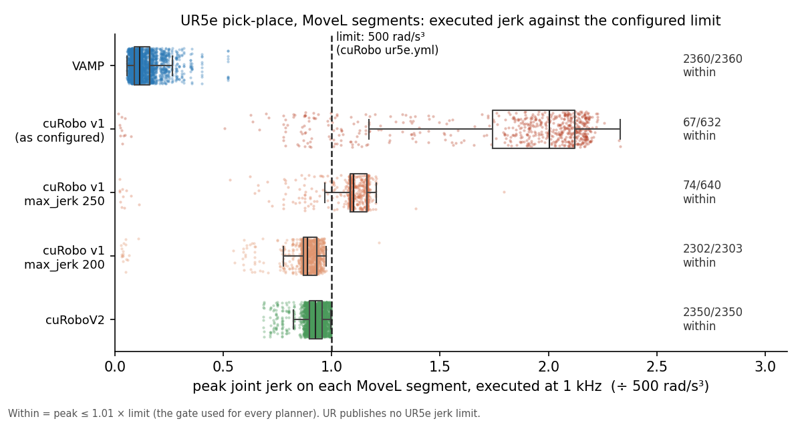

# Benchmark v2: pick-place with MoveL (results)

Pre-registration and amendments: `docs/V2_PICKPLACE_PREREGISTRATION.md`. Numbers: `results/v2/pickplace_summary.json`, produced by `bench/v2_pickplace_analyze.py` from `results/v2/raw/`.

## Setup
- **Task:**
  - 30 UR5e-on-rail cells (bin, conveyor and fixture stations), 4 picks per cell, 5 seeds: 600 picks per planner.
  - Each pick has 6 segments: free → pre-grasp, MoveL down 0.10 m, MoveL up, free → pre-place, MoveL down, MoveL up.
  - Goals are on the 2π branch nearest the configuration the robot comes from (A6).
- **Success:** every segment passes the same gate for every planner:
  - planning within T = 30 s;
  - at 1 kHz: no collision, joint bounds respected, and peak velocity, acceleration and jerk each ≤ 1.01 × limit.
- **Jerk limit:** 500 rad/s³ per arm joint. This is the value in cuRobo's shipped `ur5e.yml`; Universal Robots publishes no jerk limit for the UR5e.
- **Hardware:** one Jetson Orin NX 16 GB.
  - cuRobo v1 and cuRoboV2 ran on its GPU, with no other GPU work.
  - VAMP ran on its CPU while other jobs shared the board (1-min load average 13.6–15.6 on 8 cores), so VAMP's planning times are upper bounds.
- **MoveL per planner:**
  - **VAMP:** a straight TCP line by construction (IK every 5 mm, then time-scaled at 0.25 m/s TCP).
  - **cuRobo v1 and cuRoboV2:** their native soft line costs, with trajectories used as returned.

## Results

| | VAMP | cuRobo v1 (as configured) | cuRobo v1, max_jerk 200 (positive control) | cuRoboV2 |
|---|---|---|---|---|
| Picks completed | 587/600 | 0/600 | 572/600 | 585/600 |
| Pick slots failing on some seed (P3) | 8/120 | 120/120 | 11/120 | 3/120 |
| Pick slots failing on every seed | 0 | 120 | 3 | 3 |
| Median cycle time per completed pick | 6.08 s | — | 8.22 s | 18.92 s |
| … planning | 0.35 s | — | 2.76 s | 13.71 s |
| … execution | 5.72 s | — | 5.47 s | 5.34 s |
| MoveL max TCP deviation, median / p95 (P1) | 0.04 / 0.07 mm | 0.04 / 0.49 mm | 0.03 / 0.34 mm | 0.65 / 0.92 mm |
| MoveL max orientation deviation, p95 | 0.03° | 1.89° | 1.51° | 0.05° |
| First failure on failed picks | 12 free segments collide at 1 kHz; 1 free segment not solved | 575 jerk only; 25 free segments not planned | 27 free segments not planned; 1 jerk only | 15 free segments not planned |

- **P1, MoveL precision:** all three planners meet the pre-registered criterion (median ≤ 1 mm, p95 ≤ 5 mm).
  - VAMP's line is straight by construction, so its deviation is interpolation error only.
  - cuRobo v1 holds the line in position but has the largest orientation drift (p95 1.9°).
  - cuRoboV2 deviates about 0.65 mm in position and holds orientation within 0.05°.
- **P2, cycle time:** VAMP has the lowest median cycle time per completed pick.
  - **Paired picks:** on the 576 picks both complete, VAMP takes 6.07 s and cuRoboV2 18.88 s, a median ratio of 0.32. On the 566 picks VAMP and the v1 positive control both complete, VAMP takes 6.06 s and v1 8.22 s (ratio 0.74).
  - **Where the difference comes from:** execution times are within 0.4 s of each other, so the difference is planning time.
  - **v1 as configured:** it completes no pick, so it has no cycle time; the v1 cycle times are from the positive control.
- **P3, robustness:** cuRoboV2 has the fewest pick slots failing on some seed (3/120), VAMP 8/120, and the v1 positive control 11/120.
  - V2's 3 failing slots fail on every seed, all in free segments.
  - VAMP fails no slot on every seed. Its failures are mostly free segments whose time-parameterized trajectory touches an obstacle at 1 kHz, although the path itself is collision-free.

## The jerk gate

| Run (A6 cells) | MoveL segments within 500 rad/s³ | MoveL peak, median / max (× limit) | Free segments within |
|---|---|---|---|
| VAMP | 2360/2360 | 0.11 / 0.52 | 1192/1192 |
| cuRobo v1 as configured (max_jerk 500) | 67/632 | 2.00 / 2.33 | 582/592 |
| cuRobo v1, max_jerk 250 | 74/640 | 1.10 / 1.79 | 588/598 |
| cuRobo v1, max_jerk 200 | 2302/2303 | 0.89 / 1.22 | 1152/1152 |
| cuRoboV2 | 2350/2350 | 0.93 / 1.00 | 1175/1175 |

- **Result:** cuRobo v1's MoveL trajectories exceed the configured 500 rad/s³ jerk limit, executed at 1 kHz, by a median factor of 2.0. cuRoboV2's and VAMP's stay within it.
- **Where the excess is:** in one cell's dumped trajectories (8 MoveL segments, max_jerk 500 and 250), every over-limit sample lies in the first or last 30 ms of the segment; between the ends, jerk stays at or below 0.84 × 500.
  - The peak at the ends is 1.9–2.3 × v1's own `max_jerk`, which is why halving that setting halves the excess rather than removing it.
  - At the start, this matches v1's kernel: its jerk term is a central difference over optimizer steps, set to zero at the first step. The mechanism at the end is not traced.
- **Positive control:** with `max_jerk` = 200, v1 meets the gate on 2302 of 2303 MoveL segments and completes 572/600 picks.
  - This meets the pre-registered criterion (≥ 80%).
  - v1 therefore plans these cells; as configured, it fails them on jerk (at the segment ends, in the cell examined).
  - Its remaining failures are 27 free segments it does not plan, and one MoveL segment over the jerk limit.
- **Post hoc (not a success measure):**
  - **v1 without the jerk check:** if the jerk check alone were ignored, v1 as configured would complete 573/600 picks.
  - **TCP speed:** the task specifies 0.25 m/s TCP speed on MoveL. VAMP's peak stays at or below it. cuRobo has no TCP speed limit, and its MoveL peaks exceed 0.25 m/s on 85% (v1) and 100% (V2) of segments (p95 peak 0.47 m/s for v1, 0.42 m/s for V2), which shortens cuRobo's execution times.

## Appendix: goals not wrapped to the nearest branch (A5 cells)
- **The A5 cells:** the same cells before A6, where goals were not wrapped. 81% of free segments need some arm joint to turn more than 4.5 rad.
- **cuRobo results on them:** v1 completed 0/600 picks and cuRoboV2 120/556 (a partial run).
- **VAMP:** the A5 VAMP run is void.
- **Comparison with the main results:** on long joint moves, both cuRobo versions fail many free segments that they plan once the goals are wrapped.

## Post-hoc: uniform slowdown (R2) for every planner
Not pre-registered (amendment 7f in `docs/BENCHMARK_V2.md`). PyRoki's MoveL (v2.1) is reported both as returned (R1) and after a uniform slowdown (R2). Without the same rescue for the other planners, PyRoki would get one they did not.
- **R2:** a segment that fails the 1 kHz gate only on velocity, acceleration or jerk is slowed uniformly by s = max(1, r_v, √r_a, ∛r_j), where the r are its peak ratios to the limits. The path is unchanged and the segment is gated again.
- **How it was computed:**
  - For the v2 planners, R2 is computed from the stored per-segment peaks and collision results.
  - **Check:** it was checked first on cuRobo v1 trajectories dumped at 1 kHz. Slowed down and resampled, all 16 pass the full gate, at exactly 1.00 × the limit.
- **cuRobo v1 source:** its run that continued past jerk-only failures, so every segment is attempted.
- **Numbers:** `results/v2_1/movel_r2.json` (`bench/v2_1_movel_r2.py`).

| MoveL segments | VAMP | cuRobo v1 (as configured) | cuRoboV2 | PyRoki as pre-registered (v2.1) | PyRoki, PyRoki's endpoint recipe (v2.1, 7g) |
|---|---|---|---|---|---|
| Pass the gate as returned (R1) | 2360/2360 | 200/2304 | 2350/2350 | 0/480 | 0/480 |
| Pass the gate after slowdown (R2) | 2360/2360 | 2304/2304 | 2350/2350 | 473/479 | 474/477 |
| Succeed under R2 (gate, endpoints, budget) | 2360/2360 | 2304/2304 | 2350/2350 | 6/480 | 373/480 |
| Slowdown factor s on slowed segments, median / p95 | — (none needed) | 1.27 / 1.30 | — (none needed) | 2.09 / 5.55 | 1.90 / 5.75 |
| Added execution time per slowed segment, median | 0 | 0.10 s | 0 | 0.81 s | 0.67 s |
| MoveL execution time under R2, median | 0.75 s | 0.50 s | 0.46 s | 1.56 s | 1.42 s |

| Picks (all 6 segments) | VAMP | cuRobo v1 (as configured) | cuRoboV2 |
|---|---|---|---|
| Completed, R1 | 587/600 | 0/600 | 585/600 |
| Completed, R2 | 587/600 | 573/600 | 585/600 |
| Median cycle time per completed pick, R2 | 6.08 s | 8.15 s | 18.92 s |
| Median cycle time on the 567 picks all three complete under R2 | 6.06 s | 8.14 s | 18.86 s |

- **cuRobo v1:**
  - **With the same rescue:** cuRobo v1 as configured completes 573 of 600 picks, against 0 as returned. This is about the same as the max_jerk 200 positive control (572).
  - **Cost:** the slowdown lengthens each slowed MoveL by 27% (about 0.10 s), adding a median of 0.41 s per pick.
  - **What the rescue covers:** 2104 MoveL and 13 free segments. All of them failed the gate on jerk alone.
- **VAMP and cuRoboV2:** every segment passes as returned, so R2 changes nothing for them.
- **PyRoki:**
  - Its MoveL needs a larger slowdown (median 2.1×, up to 5.9×).
  - Under R2, PyRoki as pre-registered succeeds on only 6 segments, because it ends 2.6 mm (median) from the target pose. In that run the end was reached through a soft pose cost.
  - With PyRoki's own endpoint recipe (end configuration held, amendment 7g), it succeeds on 373/480. Of the remaining 107, 96 fail only because the start constraint is not met within 1e-3 rad at the solver's default iteration limit.
  - It ran single MoveL segments from the stored start configurations, not whole picks, so it has no per-pick numbers.
- **Ranking unchanged:** on paired picks, VAMP's cycle time is the lowest under R2 as under R1.

